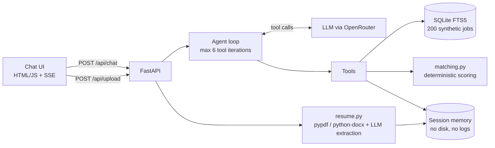

# Friday: an AI Career Copilot prototype for QuickHyre AI

Friday is a working prototype of the "coming soon" career assistant on QuickHyre's homepage. It searches jobs, explains why a candidate fits a role, checks resumes against a job, and drafts honest referral messages. It is a portfolio piece, not a QuickHyre product.

**Live demo:** https://friday-quickhyre.onrender.com/ (free tier: first load can take ~50s)


> **Sample data, not real listings.** All ~200 jobs and companies are synthetic and fictional. Nothing was scraped from quickhyre.ai or any other site. Friday has no funding, salary or live news data and says so.


## What it does

| Ability | How |
|---|---|
| Job search | SQLite FTS5 + structured filters (city, work mode, experience, internships, company type), near-duplicates collapsed |
| "Why am I a fit?" | Deterministic 0-100 score (70% skill coverage + 30% experience fit); the LLM only narrates the structured comparison |
| ATS check | Missing keywords, coverage %, formatting flags, 3 rewrites that use `[X]` placeholders instead of invented numbers |
| Referral message | Under 120 words, one clear ask, facts from the resume only |
| Honesty | Declines funding/salary/news questions and fake-experience requests |

## Architecture



## Run locally (under 5 minutes)

```bash
git clone https://github.com/Nakshatra-thange/friday-quickhyre.git && cd friday-quickhyre
python3 -m venv .venv && source .venv/bin/activate
cp .env.example .env          # add your OPENROUTER_API_KEY
make install
make run                      # http://localhost:8000
make test                     # unit tests, no API key needed
make eval                     # full eval suite, writes EVAL_REPORT.md
```

## Evals

32 cases across 7 categories: search correctness, grounding, honesty, resume match, ATS, referral, injection resistance. See [EVAL_REPORT.md](EVAL_REPORT.md) for the latest run.

- Overall: **<97>%** | Grounding: **<100>%** (from EVAL_REPORT.md)
- Model used for the run: `<model>`
- Run `python eval/run_evals.py --repeat 3` to measure flakiness.

**What the evals caught and how I fixed it** (the part I'm proudest of):
- Search: filler words like "internships" were used as text keywords and returned nothing; a single experience value leaked jobs outside the candidate's range.
- Referral: my own prompt asked for "a referral *or* a chat", so the model wrote two asks. Fixed with one deterministic ask per contact type.
- Reasoning models spent the whole token budget before writing any answer (`stop: length`, empty output). Fixed with larger budgets, retries and a safe fallback.
- Known flaky: <list any case that fails on --repeat 3, or "none observed">.

## Design decisions

- **Native tool calling, no framework.** The agent is one small loop. Every tool is a typed function with a JSON schema, so behaviour is easy to trace and test.
- **Deterministic scoring.** An LLM-invented "87% match" can't be trusted or tested. The score comes from code; the model explains it and must quote it exactly.
- **SQLite FTS5.** 200 rows don't need a vector DB. FTS5 plus structured filters is fast, debuggable and enough here.
- **Grounding by construction.** Friday may only mention jobs returned by tools, always with their `job_id`. Skills extracted from a resume are verified against the resume text to remove hallucinated ones.
- **Injection safety.** Resume and job text is treated as data. Instruction-like text in a resume is flagged at upload, and two eval cases check behaviour doesn't change.
- **Privacy.** Resumes live in memory for the session only. Logs contain tool names, counts and latency, never content.
- **Dedupe.** Normalised title + company + city + skill overlap. ~10 near-duplicates are seeded on purpose and collapsed in results.
- **Cost guards.** Per-IP rate limit and a daily token budget.

## Known limitations

- Sample data only; no real ingestion, funding, salary or news data.
- Scanned (image-only) PDFs aren't supported.
- Skill matching is vocabulary + alias based, so unusual skill names can be missed.
- In-memory sessions reset on restart and don't scale past one instance.
- The default free reasoning model is slow and rate-limited; a smaller model is better for a live demo.
- Free hosting sleeps when idle.

## What I'd do next

1. Plug into QuickHyre's real listing feed behind the same `search_jobs` schema.
2. Add embeddings for semantic search alongside FTS5 once the data is real.
3. Learn from outcomes: log (anonymised) which recommendations get applied to.
4. Add Hindi and Hinglish support.
5. Add a regression eval run in CI.

*Prototype built by <your name>. Not affiliated with QuickHyre AI.*